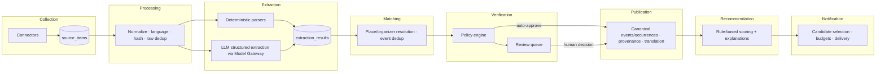

# AI City Intelligence

Status: Draft 0.2 · 2026-11-16 (Phase 1.1 corrections) · Related: [DATA_SOURCES_REGISTER.md](./DATA_SOURCES_REGISTER.md), [CONTENT_OPERATIONS.md](./CONTENT_OPERATIONS.md), [NOTIFICATION_ARCHITECTURE.md](./NOTIFICATION_ARCHITECTURE.md), [ADR-0014](./adr/ADR-0014-ai-model-gateway.md), [ADR-0015](./adr/ADR-0015-source-connector-architecture.md)

## 1. Objectives

1. Turn legitimate public and authorized information into structured, verified city data.
2. Be **source-independent**: Instagram is one connector among many; new sources are added by configuration or a new connector, never by redesigning the pipeline.
3. Never present AI output as fact without evidence and verification.
4. Reduce human work progressively ([CONTENT_OPERATIONS.md](./CONTENT_OPERATIONS.md#5-progressive-automation-ladder)) while measuring accuracy.
5. Keep cost predictable and small.

## 2. Separation of concerns (stages)

Each stage has its own module, inputs/outputs and storage. Stages communicate through database records and jobs ([ADR-0009](./adr/ADR-0009-background-jobs-pg-boss.md)), so any stage can be re-run independently.

| Stage | Responsibility | Deterministic or AI | Output |
|---|---|---|---|
| **Collection** | Fetch items from registered sources within policy | Deterministic | `source_items` (raw, retention-limited) |
| **Processing** | Clean text, detect language (az/ru/en/mixed), compute content hash, skip unchanged, strip tracking params | Deterministic | normalized item |
| **Extraction** | Produce candidate fields with evidence spans | Parsers first (ICS/JSON-LD/feeds); LLM for free text | `extraction_results` |
| **Matching** | Resolve place/organizer; detect duplicates and updates to existing events | Deterministic + fuzzy (pg_trgm, PostGIS); embeddings later | match candidates |
| **Verification** | Apply source policy; create review tasks | Deterministic policy engine + humans | approve/reject decisions |
| **Publication** | Write canonical records, field provenance, translations, lifecycle | Deterministic (+ LLM translation) | `events`, `occurrences`, `field_provenance` |
| **Recommendation** | Score and explain items for a user context | Deterministic in MVP | ranked list + reasons |
| **Notification** | Select, budget, schedule, deliver | Deterministic | notifications |

## 3. Source types (what feeds the system)

| Category | Examples | Connector types |
|---|---|---|
| Official APIs (owner-authorized) | Organizer's own Instagram professional account | `instagram_owned_account` |
| Authorized partner integrations | Cinema or ticketing feed under agreement | `partner_feed` |
| Permitted public sources | Official venue calendars via ICS/RSS/JSON-LD where terms allow | `ics_feed`, `rss_feed`, `structured_web` |
| Organizer submissions | Organizer portal; email forwarding (later) | `organizer_portal`, `email_ingest` |
| Owner-added bots | Telegram channel where owner adds Salaam bot [research] | `telegram_channel_bot` |
| Manual curation | Curator entry from verified public facts | `manual_entry` |
| Open data | OpenStreetMap places | `osm_import` |
| Future partners | Mobility stations, retail offers | `partner_feed` |

## 4. Connector types

All connectors implement one conceptual contract (specified here; implemented in P-3):

| Capability | Description |
|---|---|
| `describe()` | Static metadata: type, required credentials, supported content (text/image), default trust tier |
| `validateConfig(config)` | Checks a source configuration (URL, account id, schedule) |
| `collect(source, cursor)` | Returns new/changed raw items since cursor, respecting rate limits; never bypasses authentication or protections |
| `toRawItem(native)` | Maps provider payload to the common raw item shape (id, url, published_at, author/source handle, text, media refs, language hint) |
| `health()` | Last success, error counts, quota usage |

Each source (DS record) declares: connector type, credentials reference (encrypted), schedule, max frequency, retention days, store-images flag, attribution template, default trust tier, automation level.

**Adding a source** = new DS record + config (if the connector type exists). **Adding a source type** = one new connector implementing the contract; no change to later stages.

| Connector | MVP? | Notes |
|---|---|---|
| `manual_entry` | ✓ | Admin forms |
| `organizer_portal` | ✓ | Web form → raw item (structured fields, so extraction mostly skipped) |
| `ics_feed`, `rss_feed` | ✓ | Cheap, deterministic |
| `structured_web` | ✓ (per-site approval) | Reads schema.org `Event` JSON-LD only where permitted |
| `instagram_owned_account` | ✓ if Meta approves | Posts only; images per consent |
| `osm_import` | ✓ | One-off + periodic refresh for places |
| `partner_feed` | When a partner exists | CSV/JSON/API |
| `telegram_channel_bot` | Research | |
| `email_ingest` | Next | |
| `instagram_business_discovery` | ✗ pending legal | |

## 5. Scheduling

| Job | Default schedule | Notes |
|---|---|---|
| Collect: high-value T1 sources | Every 2–6 h (≤ source's permitted frequency) | Hourly only where explicitly permitted and useful |
| Collect: other sources | Daily | |
| Re-verify upcoming occurrences with saves | T−48 h and T−6 h | Re-collect source; flag changes as `field_conflict` |
| Expire ended occurrences | Every 15 min | `lifecycle_status=ended` when end (or start + default duration) passes |
| Purge raw items past retention | Daily | Per-source retention |
| Audit sampling | Daily | Creates `audit` tasks per [CONTENT_OPERATIONS.md](./CONTENT_OPERATIONS.md#5-progressive-automation-ladder) |
| Translation of newly published items | On publish (batched every 15 min) | |
| Digest preparation | Thu 17:00 & daily 16:00 Asia/Baku | Feeds notifications |
| On-demand re-check | Curator-triggered | User-triggered "refresh" not in MVP |

[CONFIRMED rule] Do not assume a platform permits hourly collection; frequency comes from the DS record.

## 6. Extraction specification

**Target fields** (all optional; none invented):

| Field | Type | Notes |
|---|---|---|
| `title` | text + language | |
| `description` | text + language | Summarised only if source text >1,500 chars; summary labelled |
| `category` | enum (fixed taxonomy) | |
| `occurrences[]` | start date, start time, end, `time_unknown` flag | Explicit dates are taken as written. Relative expressions ("this Friday", "tomorrow") are resolved deterministically against `published_at` in Asia/Baku, but marked **`derived=true`** and always sent to human review. Derived dates are never auto-approved at any level |
| `place_name`, `address_text` | text | Resolution done in Matching |
| `organizer_name` | text | |
| `price` | min, max, currency, `is_free` | Only if explicitly stated |
| `ticket_url` | URL | Must appear in source |
| `lifecycle_signal` | none / cancelled / postponed / sold_out | Never auto-applied |
| `age_restriction`, `event_language` | optional | |

Every extracted field carries: `value`, `evidence_span` (exact quote or offset from source text), `confidence` (0–1), `method` (`parser`, `llm`, `human`). **Rule:** a field without an evidence span is discarded, except derived fields (e.g. resolved date) which reference the span they were derived from.

**Validation after extraction (deterministic):** dates within plausible window (−1 day … +365 days); URL domain allow/deny lists; currency AZN default only if "AZN/₼/manat" appears; times in 00:00–23:59; schema validation; mismatch → field dropped and task flagged.

## 7. Matching and deduplication

1. **Place resolution:** alias table exact match → trigram similarity on name within the city → distance check if coordinates exist → candidate list; below threshold → curator chooses or creates.
2. **Event duplicate detection:** candidates where same place (or ≤200 m), start within ±3 h, and title trigram similarity ≥0.4 (tunable) → `possible_duplicate` task. Cross-language titles handled by comparing against all stored locale variants. Embedding similarity (pgvector) added only if precision is insufficient ([ADR-0008](./adr/ADR-0008-pgvector-deferred.md)).
3. **Updates:** an item from the same source referencing an existing event (same source URL/ID) updates it; changes to critical fields create `field_conflict` unless the source is at L3+.

## 8. Verification and publication

- Policy engine evaluates per-source rules ([CONTENT_OPERATIONS.md](./CONTENT_OPERATIONS.md#5-progressive-automation-ladder)). **[CONFIRMED 2026-11-16] Through MVP-1 every source is L0/L1: the pipeline only produces drafts, and every item is human-approved before publication (D-25).** L2+ requires statistical evidence and founder approval.
- The pipeline can never set or change lifecycle (cancelled/postponed) or availability (sold out); it only raises `lifecycle_signal` tasks.
- Publication writes `field_provenance` rows for each critical field and sets `trust_tier`, `verification_status`, `last_verified_at`.
- Users never see `pending_review` items. Field-level unverified values are displayed with an "unconfirmed" marker or hidden (price, time).
- Status model: [ADR-0019](./adr/ADR-0019-status-model-two-axes.md).

## 9. Recommendation (MVP: deterministic)

Score = weighted sum of: time fit (within requested lens / user's free window), distance from chosen area (if any), interest match, "things I have" match (camera → photo-friendly places; bike → cycling-friendly), friends going (if visible), freshness/verification bonus, popularity (saves), diversity penalty (avoid 5 similar items). Each component produces a human-readable reason; the top 1–2 reasons are shown ("Jazz · 1.2 km · 2 friends going"). Weather adjustment (indoor bias in rain) once a weather source is approved. ML ranking is a "Later" consideration once interaction data exists.

## 10. AI safety and security

| Risk | Control |
|---|---|
| Prompt injection inside collected content | Extraction model has **no tools** and no access to data beyond the item; content passed as quoted data with explicit instruction that it is untrusted; output must match JSON schema; post-validation drops anything off-schema |
| Hallucinated details | Evidence-span requirement; deterministic validation; human review per policy |
| Data leakage | Pipeline prompts contain only source content (public/organizer-provided), never user personal data |
| Excessive permissions | Model gateway issues no write actions; publication done by deterministic code after policy/human approval |
| Malicious URLs/media | URL allow/deny checks; images re-encoded; no auto-fetch of arbitrary links from content in MVP |

See also [SECURITY_AND_PRIVACY.md](./SECURITY_AND_PRIVACY.md#7-ai-specific-security).

## 11. Cost control

| Mechanism | Effect |
|---|---|
| Content hash skip | Unchanged items never reach the LLM |
| Parsers before LLM | ICS/JSON-LD/portal items need no LLM extraction |
| Small default model | Claude Haiku 5.5 is priced at $0.10 / $0.50 per million input/output tokens for prompts up to 100k tokens (checked 2026-11-14, secondary sources citing Anthropic's pricing) |
| Batch processing | Non-urgent extraction via batch API at about half price where supported |
| Prompt caching | Shared system prompt cached |
| Budgets | Daily and monthly spend caps in the model gateway; on cap → queue items for next day, alert founder |
| Per-source budget | Noisy sources limited to N items/day |
| Metrics | Cost per published item, tokens per item, cache hit rate |

Worked estimate (assumption: ~2,000 input + ~400 output tokens per item): ≈ $0.0004 per item on Haiku 5.5 → ~$4 per 10,000 items/month before batch/caching discounts. See [COST_AND_RESOURCE_ESTIMATE.md](./COST_AND_RESOURCE_ESTIMATE.md).

## 12. AI city assistant (post-MVP)

Deferred (D-16) because it needs dense verified data and careful safety work. Design constraints when built: read-only tools over Salaam's own database (search occurrences, search places, compute route); no web browsing; answers cite item IDs rendered as cards with trust badges; explicit "I don't know" when data is missing; user text treated as personal data (cross-border question QL-04 applies because LLM APIs run outside Azerbaijan).

## 13. Quality evaluation

- **Gold set:** ~300 real announcements (az, ru, en, mixed) collected during P-0 with hand-labelled fields; stored without personal data.
- **Metrics:** per-field precision/recall, evidence-span validity, schema-valid rate, cost per item.
- **Gate:** a prompt or model change ships only if critical-field precision does not drop on the gold set ([TESTING_STRATEGY.md](./TESTING_STRATEGY.md#5-ai-evaluation)).
- **Prompt versioning:** prompts stored in the repository with version IDs; `extraction_runs` record prompt version and model.

## 14. Limitations (explicit)

- Stories and many announcements will remain invisible unless organizers submit or connect.
- Coverage will be uneven by category and language at launch.
- Extraction quality for mixed az/ru informal text is unknown until the gold set is measured.
- Cancellations are often announced informally; detection is a suggestion, not automation.
