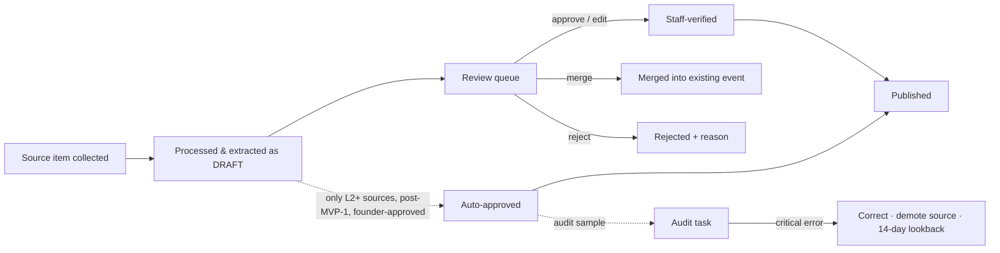

# Content Operations

Status: Draft 0.2 · 2026-11-16 (automation ladder and workload recalibrated) · Related: [AI_CITY_INTELLIGENCE.md](./AI_CITY_INTELLIGENCE.md), [DATA_SOURCES_REGISTER.md](./DATA_SOURCES_REGISTER.md), [CONTENT_VALIDATION_WORKBOOK.md](./CONTENT_VALIDATION_WORKBOOK.md), [UX_UI_SPECIFICATION.md](./UX_UI_SPECIFICATION.md#414-admin-console)

- [CONFIRMED] Human verification is accepted initially; the architecture must support progressively increasing automation without compromising reliability.
- [CONFIRMED 2026-11-16] **For the early MVP, every item is approved by a human before publication.** AI never silently invents or assumes event dates, locations, prices, availability or cancellation status.

## 1. Roles

| Role | Who (MVP) | Permissions |
|---|---|---|
| Admin | Founder | Everything incl. sources, roles, automation levels |
| Curator | Founder (later: part-time freelancers) | Review queue, content CRUD, translations |
| Moderator | Founder | Reports, user actions |
| Organizer | External (verified) | Own submissions and profile only |

## 2. Content lifecycle

## 3. Review queue

**Task types**

| Type | Created when | Expected handling |
|---|---|---|
| `new_item` | A draft was extracted (all drafts in MVP) | Approve / edit / reject |
| `possible_duplicate` | Matching found candidate duplicates above threshold | Merge / keep separate |
| `field_conflict` | New source item contradicts a published field (e.g. time changed) | Accept change / keep / mark unconfirmed |
| `lifecycle_signal` | Text suggests cancellation/postponement/sold out | Confirm / dismiss (always human) |
| `audit` | Random sample of auto-approved items (L2+ only) | Confirm correct / record errors |
| `organizer_claim` | Organizer claims a profile | Verify identity (manual) |
| `report` | User report | Moderate |

**Priority order:** lifecycle signals for items with saves → field conflicts on upcoming items → new items starting within 72 h → duplicates → other new items → audits → claims.

**Review screen requirements (F-072):** source evidence (text, image, link) on the left; extracted fields on the right with highlighted evidence spans and confidence; **derived values flagged** (e.g. a date resolved from "this Friday"); place auto-suggestions; one-key actions (A approve, E edit, M merge, R reject, S skip); reason codes on reject; time-on-task captured automatically.

## 4. Verification rules (what a curator checks)

| Field | Rule |
|---|---|
| Title | Matches source; no clickbait added; language tagged |
| Date/time | Explicit in source or official calendar; timezone Asia/Baku; relative expressions ("this Friday") are **derived** and must be confirmed by the curator; if only the date is known → `time_unknown=true` (never guessed) |
| Place | Resolved to an existing place, or new place created with address/coordinates verified on a map |
| Price | Shown only if the source states it; "free" only if explicitly stated |
| Availability | `sold_out`/`unavailable` only on an explicit statement |
| Ticket link | Official ticketing or organizer page; no shortened unknown links |
| Image | Only from the source with display permission; otherwise category illustration |
| Lifecycle | Cancelled/postponed only on explicit signal from organizer/official source — **never automated at any level** |

## 5. Progressive automation ladder

### 5.1 Why the 0.1 thresholds were changed

The 0.1 ladder allowed auto-approval after 30 reviewed items at "≥98% accuracy". Statistically, 30 error-free items only show (95% confidence, "rule of three": upper error bound ≈ 3/n) that the error rate is **below ~10%**, not below 2%. Operationally, a small venue posting 4 events a month would need years to reach meaningful per-source samples. The ladder is therefore based on **pooled evidence per connector class** plus a smaller **per-source sanity check**, and higher levels only open after MVP-1.

**Sample size needed to claim a maximum critical-error rate (95% one-sided confidence):**

| Claimed max error rate | Precision claimed | n with 0 errors (rule of three) | Max errors allowed at larger n (approx., exact binomial) |
|---|---|---|---|
| 3% | 97% | 100 | 1 error at n ≈ 160 |
| 2% | 98% | 150 | 1 error at n ≈ 240 |
| 1% | 99% | 300 | 1 error at n ≈ 475 |
| 0.5% | 99.5% | 600 | 1 error at n ≈ 950 |

"Critical error" = any critical field wrong in the draft as extracted: title meaningfully wrong, start date/time, place, lifecycle, ticket URL, or a price that would be displayed. An item counts as one trial.

### 5.2 Two evidence tracks

| Track | Sources | Where errors come from | Pooled evidence unit |
|---|---|---|---|
| **Structured** | ICS/RSS/JSON-LD calendars, partner feeds, verified-organizer form | Mostly the source itself (wrong data), parsing bugs | Connector class (e.g. all ICS sources) |
| **Free-text (LLM)** | Organizer-connected social posts, emails | Extraction and interpretation | Pipeline gold set + audits |

### 5.3 Levels

| Level | Applies to | Behaviour | Required evidence to enter | Critical-field precision required | Human audit | Automatic demotion | Rollback |
|---|---|---|---|---|---|---|---|
| **L0 Manual** | Unpermitted-for-automation or low-trust sources (T4/T5) | Curator creates/edits; no extraction | — | n/a | 100% human | — | — |
| **L1 Assisted** — **default for all sources; mandatory through MVP-1** | All sources | Parser/LLM produce drafts; **every item human-approved before publication** | None (entry level) | n/a (measured: draft correctness, edits = errors) | 100% human | — | — |
| **L2 Structured auto-publish** (post-MVP-1, founder approval per source) | T1/T2 structured sources | New items publish automatically **only if** all critical fields present and valid, place resolved, no conflict. Lifecycle, availability, price changes and new places still go to humans | Connector class: ≥150 consecutive reviewed items with 0 critical errors (or ≤1 in ≥240) · this source: ≥30 reviewed with 0 critical errors · ≥6 weeks at L1 | ≥98% (95% upper error bound ≤2%) | Per source per week: max(10 items, 20%); plus every auto-published item that has saves before its start, if the source can be re-checked | Any critical error in audit → back to **L1** · parse/validation failure >5% in a run → paused to L1 · source terms change → L0 pending review | Re-review all items auto-published from that source in the last 14 days; wrong items corrected or returned to `pending_review` (hidden); users who saved them get a change alert |
| **L3 Free-text auto-publish** (post-MVP-1, founder approval per source) | T1 organizer-owned free-text sources | As L2, for LLM-extracted items; derived dates, prices, availability and lifecycle **always** human | Gold set ≥300 items with ≤1 critical error (≥98% at 95% confidence) **and** this source ≥50 reviewed with 0 critical errors **and** ≥8 weeks at L1 | ≥98% pooled; 100% on source sample | max(10, 25%) per source per week **+** 5% global random sample | Any critical error → **L1** + 14-day lookback · **any prompt or model change → all L3 sources to L1** until the gold set is re-run and passes | Same as L2 |
| **L4 Exception-only** | T2 partner feeds with contractual data quality | Only conflicts, lifecycle signals and validation failures reach humans | ≥600 audited items over ≥60 days with 0 critical errors (≥99.5%) | ≥99.5% | 5% (min 20 items/week) | Any critical error → **L2** | Same as L2 |

**Never automated at any level:** cancellation/postponement, sold-out/availability changes, "free" without an explicit statement, new places, items with derived (inferred) dates.

All level changes require founder approval, are written to the audit log and appear on the quality dashboard. Thresholds are reviewed once real data exists (after MVP-1), never lowered without a recorded decision.

## 6. Metrics (quality dashboard, F-075)

| Metric | Definition | MVP-1 target |
|---|---|---|
| Draft critical correctness (per connector class, per source) | Drafts with all critical fields correct ÷ reviewed drafts | ≥90% (extraction useful); tracked toward L2/L3 evidence |
| Published critical-field correctness | Weekly random audit (≥20 items or all if fewer) of published items | ≥95% |
| Auto-approval precision (L2+ only) | Correct ÷ audited auto-approved items | ≥98% |
| Curator minutes per published item | Median time-on-task | ≤4 min (MVP-1), ≤2 min (MVP-2) |
| Queue age | p90 age of `new_item` tasks for events within 72 h | ≤24 h (MVP-1) |
| Automation share | Published items not touched by humans ÷ published | 0% in MVP-1 by design; rising after |
| Freshness | Share of upcoming saved occurrences re-verified ≤24 h before start | ≥80% (where source allows) |

## 7. Routines (solo founder, private beta, ~5 h/week)

| Cadence | Routine | Time |
|---|---|---|
| Mon, Wed, Thu (3×/week) | Process queue (lifecycle → conflicts → ≤72 h items) | 3 × 50–60 min |
| Thursday | Weekend re-verification of saved items | 30 min |
| Weekly | Gaps check by category; source health; weekly audit sample | 45 min |
| Monthly | Source register review (terms changes, suspensions) | 1 h |

## 8. Solo-founder workload model

[CONFIRMED] Total founder capacity is 10–15 h/week **for the whole project**. Content operations get a fixed budget per period:

| Period | Content ops budget (expected) | Range (cons.–opt.) | What it buys |
|---|---|---|---|
| P-0 validation | 3.5 h/week | 3–4.5 | Pilot curation 30→50 items/week (it is the validation itself) |
| P-1 – P-2 | 1.5 h/week (D-22) | 0–2 | Pilot upkeep at 1 post/week, or paused |
| P-3 – P-5 | 2.5 h/week | 2–3 | Curation moves into the admin; G3 needs ≥40 verified/week for 2 weeks |
| Private beta (Lean MVP-1) | **5 h/week** | 4–6 | See throughput below |

**Private-beta throughput (estimate, to be replaced by measured data):** of 5 h, about 1.25 h goes to routines, leaving ~225 minutes for item handling. Handling time depends on source mix: structured feed item ≈1 min, organizer form ≈2 min, manual entry from an official page ≈4–5 min. Example mix: 30 feed + 20 form + 25 manual ≈ 30 + 40 + 115 = 185 min → **~75 items/week**.

Resulting MVP-1 supply target: **min 40, target 60, stretch 100** verified events/week (cinema showtimes counted separately). This replaces the 0.1 target of ≥100 and ≤8 h/week ([MVP_SCOPE.md](./MVP_SCOPE.md#5-success-metrics), D-10).

If content ops exceed 6 h/week for 3 consecutive weeks: narrow categories, reduce manual-entry sources, or add a part-time curator (Scenario C, [COST_AND_RESOURCE_ESTIMATE.md](./COST_AND_RESOURCE_ESTIMATE.md#5-scenarios)).

## 9. Sustainable initial content strategy

[RECOMMENDED] For P-0 through MVP-1:

1. **Few, high-quality sources:** 15–25 active sources in 3–4 categories, chosen by reliability and permission ([CONTENT_VALIDATION_WORKBOOK.md](./CONTENT_VALIDATION_WORKBOOK.md#3-source-evaluation-template-sourcescsv)).
2. **Official organizer information first:** organizer submissions and organizers who confirm their events; official institution pages.
3. **Structured where possible:** ICS/RSS/JSON-LD feeds and partner feeds where terms permit (cheapest to process, best for future automation).
4. **Manual entry as fallback:** curator records facts in own words with a link to the official source; no copying of text or images (QL-07 pending).
5. **Freshness and provenance always:** every item has source URL, `last_verified_at`, change log; weekend items re-checked on Thursday.
6. **No dependence on Instagram automation:** no scraping; Instagram used only as a manually referenced public source or, later, via organizer-authorized connection after Meta App Review.

## 10. What can be automated vs what needs a human

| Activity | Automatable? | Notes |
|---|---|---|
| Collection on schedule | Yes | Within source policy |
| Language detection, normalisation, raw dedup | Yes | Deterministic |
| Field extraction | Yes (drafts) | Evidence spans; human-approved in MVP |
| Place matching | Suggest | Humans confirm; humans create new places |
| Duplicate detection | Suggest only | Human merges |
| Publication | Human in MVP; L2–L4 later with evidence | Audited |
| Translation | Yes | Labelled; humans spot-check |
| Cancellation / availability | **Never** | Human confirms explicit signal |
| Organizer identity verification | No | Human |
| Moderation decisions | No | Spam heuristics only |
| Partnerships, legal review | No | Founder/counsel |
| Avatar art | No (tools assist) | Human designer |

## 11. Freelance curators (optional future)

Onboarding kit: verification rules (§4), reason codes, 20-item training set from gold data, shadow week (their decisions compared to founder's), then independent work with 10% founder review. Access: curator role only; no access to user personal data.
