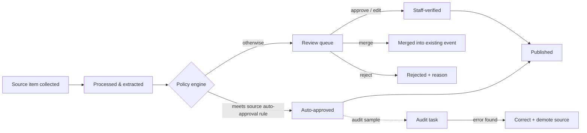

# Content Operations

Status: Draft 0.1 · 2026-11-14 · Related: [AI_CITY_INTELLIGENCE.md](./AI_CITY_INTELLIGENCE.md), [DATA_SOURCES_REGISTER.md](./DATA_SOURCES_REGISTER.md), [UX_UI_SPECIFICATION.md](./UX_UI_SPECIFICATION.md#414-admin-console)

[CONFIRMED] Human verification is accepted initially; the architecture must support progressively increasing automation without compromising reliability.

## 1. Roles

| Role | Who (MVP) | Permissions |
|---|---|---|
| Admin | Founder | Everything incl. sources, roles, automation levels |
| Curator | Founder (later: part-time freelancers) | Review queue, content CRUD, translations |
| Moderator | Founder | Reports, user actions |
| Organizer | External (verified) | Own submissions and profile only |

## 2. Content lifecycle

## 3. Review queue

**Task types**

| Type | Created when | Expected handling |
|---|---|---|
| `new_item` | Extraction produced a candidate event/place not auto-approved | Approve / edit / reject |
| `possible_duplicate` | Matching found candidate duplicates above threshold | Merge / keep separate |
| `field_conflict` | New source item contradicts a published field (e.g. time changed) | Accept change / keep / mark unconfirmed |
| `lifecycle_signal` | Text suggests cancellation/postponement/sold out | Confirm / dismiss |
| `audit` | Random sample of auto-approved items | Confirm correct / record errors |
| `organizer_claim` | Organizer claims a profile | Verify identity (manual) |
| `report` | User report | Moderate |

**Priority order:** lifecycle signals for items with saves → field conflicts on upcoming items → new items starting within 72 h → duplicates → other new items → audits → claims.

**Review screen requirements (F-072):** source evidence (text, image, link) on the left; extracted fields on the right with highlighted evidence spans and confidence; place auto-suggestions; one-key actions (A approve, E edit, M merge, R reject, S skip); reason codes on reject; time-on-task captured automatically.

## 4. Verification rules (what a curator checks)

| Field | Rule |
|---|---|
| Title | Matches source; no clickbait added; language tagged |
| Date/time | Explicit in source or official calendar; timezone Asia/Baku; if only date known → `time_unknown=true` (never guessed) |
| Place | Resolved to an existing place, or new place created with address/coordinates verified on a map |
| Price | Shown only if the source states it; "free" only if explicitly stated |
| Ticket link | Official ticketing or organizer page; no shortened unknown links |
| Image | Only from the source with display permission; otherwise category illustration |
| Lifecycle | Cancelled/postponed only on explicit signal from organizer/official source |

## 5. Progressive automation ladder

Automation is granted **per source**, earned with measured accuracy, and revoked automatically on errors.

| Level | Name | Behaviour | Entry criteria | Audit sample |
|---|---|---|---|---|
| L0 | Manual | Curator creates/edits everything; extraction may pre-fill | Default for T4/T5 sources | n/a |
| L1 | Assisted | AI extracts; every item reviewed | Default for new T1–T3 sources | n/a (all reviewed) |
| L2 | Policy auto-approve | Auto-approve if: all critical fields present, each critical field confidence ≥0.90, place resolved with high confidence, no conflict with published data | Source T1/T2/T3 **and** ≥30 reviewed items **and** critical-field accuracy ≥98% over last 30 | 20% |
| L3 | Broad auto-approve | As L2 with relaxed non-critical requirements; updates to existing events auto-applied | ≥100 reviewed/audited items at L2 **and** audited precision ≥99% | 10% |
| L4 | Exception-only | Only conflicts, lifecycle signals and low-confidence fields reach humans | Partner feeds (T2) with contractual data quality **and** ≥99.5% audited precision over 60 days | 5% |

**Demotion:** any audit failure on a critical field → drop one level immediately and re-queue that source's items published in the last 7 days for spot-check. Two failures in 30 days → drop to L1.

Thresholds are initial defaults; tuned with data from P-5. All changes are logged (audit log) and visible on the quality dashboard.

## 6. Metrics (quality dashboard, F-075)

| Metric | Definition | MVP-1 target |
|---|---|---|
| Field accuracy (per field, per source) | Correct fields ÷ reviewed fields (edits count as errors of extraction) | ≥90% extraction; ≥95% published |
| Auto-approval precision | Correct auto-approved items ÷ audited auto-approved items | ≥98% |
| Published critical-field correctness | Weekly random audit of all published | ≥95% |
| Curator minutes per published item | Median time-on-task | ≤3 min |
| Queue age | p90 age of `new_item` tasks for events within 72 h | ≤12 h |
| Automation share | Published items not touched by humans ÷ published | Rising trend |
| Freshness | Share of upcoming saved occurrences re-verified ≤24 h before start | ≥90% (where source allows) |

## 7. Daily/weekly routines (solo founder)

| Cadence | Routine | Time |
|---|---|---|
| Daily (weekday) | Process queue (lifecycle → conflicts → ≤72 h items) | 30–45 min |
| Twice weekly | New sources & organizer claims | 30 min |
| Weekly (Wed) | Weekend completeness check (categories with gaps) | 45 min |
| Weekly | Audit queue + quality dashboard review; adjust automation levels | 30 min |
| Monthly | Source register review (terms changes, suspensions) | 1 h |

## 8. Solo-founder workload model

Estimate (to be measured in P-0/P-5): if median handling is 3 min/item and 120 items/week need human touch → 6 h/week + ~2 h routines ≈ **8 h/week** (D-10). Each point of automation share above 0% reduces this proportionally. If workload exceeds 10 h/week for 3 consecutive weeks: reduce category scope or add a part-time curator (Scenario C, [COST_AND_RESOURCE_ESTIMATE.md](./COST_AND_RESOURCE_ESTIMATE.md#4-scenarios)).

## 9. What can be automated vs what needs a human

| Activity | Automatable? | Notes |
|---|---|---|
| Collection on schedule | Yes | Within source policy |
| Language detection, normalisation, dedup of raw items | Yes | Deterministic |
| Field extraction | Yes (LLM + parsers) | With evidence spans |
| Place matching | Mostly | Humans for new places |
| Duplicate detection | Suggest only (MVP) | Human merges |
| Publication of T1/T2 items | Progressive (L2–L4) | Audited |
| Translation | Yes | Labelled; humans spot-check |
| Cancellation detection | Suggest only | Human confirms (high harm if wrong) |
| Organizer identity verification | No | Human |
| Moderation decisions | No | Human; automation only for spam heuristics |
| Partnerships, legal review | No | Founder/counsel |
| Avatar art | No (tools assist) | Human designer |

## 10. Freelance curators (optional future)

Onboarding kit: verification rules (§4), reason codes, 20-item training set from gold data, shadow week (their decisions compared to founder's), then independent work with 10% founder review. Access: curator role only; no access to user personal data.
