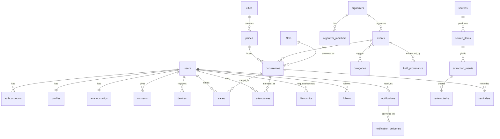

# Database Design

Status: Draft 0.2 · 2026-11-16 (Phase 1.1 corrections) · Related: [SYSTEM_ARCHITECTURE.md](./SYSTEM_ARCHITECTURE.md), [ADR-0006](./adr/ADR-0006-postgresql-postgis.md), [ADR-0019](./adr/ADR-0019-status-model-two-axes.md), [SECURITY_AND_PRIVACY.md](./SECURITY_AND_PRIVACY.md)

> Specification level. No migrations are created. Types are PostgreSQL types; `uuid` primary keys (time-ordered UUIDv7 recommended) unless stated. All tables have `created_at`, `updated_at` (timestamptz) unless noted.

## 1. Conventions

- Times: `timestamptz` (UTC); local wall-clock for occurrences also stored (`local_start`, `tz='Asia/Baku'`).
- Localized text: `jsonb` keyed by locale, e.g. `{"az": "...", "ru": "...", "en": "..."}`, plus `original_locale`; translation metadata in `translations_meta` jsonb (`{"en": {"method": "machine", "model": "...", "at": "..."}}`). Rationale: few localized fields, simpler than a separate translations table; reconsider if many locales are added ([ADR-0018](./adr/ADR-0018-localization-strategy.md)).
- Geography: `geography(Point, 4326)`.
- Soft delete only where needed for audit (`deleted_at`); personal data hard-deleted on account deletion.
- Privacy class per column: **P0** public content · **P1** personal non-sensitive · **P2** personal sensitive (location, social graph, consents) · **S** secret (tokens, credentials).

## 2. ERD (core)

## 3. Identity, consent, profile

| Table | Key fields | Constraints / indexes | Privacy | Retention |
|---|---|---|---|---|
| `users` | id, status (`active/suspended/deleted`), primary_locale, age_confirmed_at, age_policy_version | — | P1 | Until deletion (+30 d purge) |
| `auth_accounts` | id, user_id, provider (`email/google/apple/phone`), provider_subject, email (nullable) | unique(provider, provider_subject) | P1/S | With user |
| `sessions` | id, user_id, refresh_token_hash, device_id, expires_at, revoked_at | index(user_id) | S | 90 d after expiry |
| `consents` | id, user_id, purpose (`terms`, `privacy`, `location_reco`, `personalized_notifications`, `social_visibility`, `interaction_personalization`, …), document_version, granted (bool), at, source (`app/web`). **No IP stored** unless counsel requires it (QL-02); then `ip_encrypted` with defined retention | index(user_id, purpose) | P2 | Retain as evidence per counsel (QL-06) |
| `profiles` | user_id (PK), display_name, username (unique, citext), bio, interests (text[] of taxonomy ids), things_i_have (text[]), home_district_id (nullable FK → `districts`; voluntarily chosen, user can clear) | unique(username) | P1/P2 | With user |
| `privacy_settings` | user_id (PK), field_audiences (jsonb: field → `only_me/friends/public`), default_attendance_visibility, friend_request_policy | — | P2 | With user |

## 4. Avatar

| Table | Key fields | Notes |
|---|---|---|
| `avatar_catalog_items` | id (`slot.variant`), slot, rarity, unlock_rule (jsonb), conflicts (text[]), assets (jsonb per renderer: `{rive: {...}, static: {...}}`), catalog_version, active | P0 content |
| `avatar_configs` | user_id (PK), schema_version, config (jsonb, see [AVATAR_ART_SPEC.md](./AVATAR_ART_SPEC.md#6-avatar-configuration-schema-renderer-independent)), static_render_key (object storage), updated_at | Validate ids against catalog on write |
| `user_avatar_items` | user_id, item_id, unlocked_at, reason | Next (F-013) |

## 5. City data

### 5.1 Places, organizers, categories

| Table | Key fields | Indexes |
|---|---|---|
| `cities` | id, slug, name (jsonb), timezone, bbox (geography polygon), active | unique(slug) |
| `districts` | id, city_id, slug, name (jsonb), area (geography polygon, public boundary data) | unique(city_id, slug); GiST(area) |
| `places` | id, city_id, kind (`venue/cinema/cafe/restaurant/park/museum/bike_station/landmark/other`), name (jsonb), address (jsonb), location (geography), geohash7, opening_hours (jsonb, nullable), website, external_refs (jsonb: osm id, etc.), trust_tier, verification_status, last_verified_at | GiST(location); GIN trigram on normalized names; index(city_id, kind) |
| `place_aliases` | place_id, alias, locale, normalized | GIN trigram(normalized) |
| `organizers` | id, name (jsonb), kind, website, instagram_handle, verified (bool), claimed_by_user_id | trigram on name |
| `organizer_members` | organizer_id, user_id, role (`owner/editor`) | unique(organizer_id, user_id) |
| `categories` | id, parent_id, slug, name (jsonb), sort | Fixed taxonomy, admin-managed |

### 5.2 Events and occurrences

| Table | Key fields | Constraints / indexes |
|---|---|---|
| `events` | id, city_id, organizer_id (nullable), primary_place_id (nullable), title (jsonb), description (jsonb), original_locale, translations_meta, category_ids (via join), image_key, ticket_url, price_min, price_max, currency, is_free (nullable), age_restriction, event_language, trust_tier, verification_status, lifecycle_status, availability, last_verified_at, published_at, search_tsv (generated, multi-config), canonical_source_item_id | index(city_id, lifecycle_status); GIN(search_tsv); GIN trigram(title normalized) |
| `event_categories` | event_id, category_id | PK(event_id, category_id) |
| `occurrences` | id, event_id, place_id, film_id (nullable), starts_at, ends_at (nullable), local_start, time_unknown (bool), lifecycle_status, availability, format (jsonb: e.g. `{"screen":"IMAX","lang":"ru","subs":"az"}`) | index(starts_at) WHERE lifecycle_status='scheduled'; index(place_id, starts_at); check(ends_at IS NULL OR ends_at > starts_at) |
| `films` | id, title (jsonb), original_title, runtime_min, age_rating, poster_key, external_refs | Cinema module |

**Publication invariant:** an event/occurrence is publicly visible only if `verification_status IN ('auto_approved','staff_verified')` and `lifecycle_status <> 'ended'` (cancelled visible via direct link only).

### 5.3 Provenance

| Table | Key fields | Notes |
|---|---|---|
| `field_provenance` | id, entity_type (`event/occurrence/place`), entity_id, field, value_hash, source_item_id (nullable), method (`partner/parser/llm/human`), evidence (text excerpt ≤500 chars or offsets), confidence, verified (bool), verified_by (user id/null), verified_at | index(entity_type, entity_id, field); latest row per field = current |

### 5.4 Sources and pipeline

| Table | Key fields | Retention | Privacy |
|---|---|---|---|
| `sources` | id (`DS-nnn` reference), name, connector_type, config (jsonb), credentials_ref (→ encrypted secret), schedule, max_frequency, retention_days, store_images, attribution (jsonb), default_trust_tier, automation_level (`L0–L4`), status, legal_basis, evidence_ref, reviewed_at | Permanent (record) | P0/S |
| `source_items` | id, source_id, external_id, url, published_at, author_handle, raw_text, raw_media (jsonb refs), content_hash, language, collected_at, purge_after | Per source (default 90 d) | May contain personal data → minimise |
| `extraction_runs` | id, source_item_id, method, model, prompt_version, tokens_in, tokens_out, cost_usd, status, error | 12 months | P0 |
| `extraction_results` | id, run_id, fields (jsonb: value, evidence, confidence per field), validation_errors | 12 months | P0 |
| `match_candidates` | id, extraction_result_id, candidate_type, candidate_id, score, features (jsonb) | 90 d | P0 |
| `review_tasks` | id, type, priority, status (`open/in_progress/done/skipped`), payload refs, assigned_to, due_at, opened_at, closed_at, handling_seconds | 24 months | P0/P1 |
| `review_decisions` | id, task_id, decision (`approve/edit/merge/reject`), reason_code, diff (jsonb), decided_by, decided_at | 24 months | P1 (curator id) |
| `audit_samples` | id, entity_ref, source_id, sampled_at, result (`correct/error`), error_fields | 24 months | P0 |
| `outbox_events` | id, type, payload, created_at, processed_at | 7 d after processing | varies |

`pg-boss` manages its own job tables in a separate schema.

### 5.5 Saves and reminders

| Table | Key fields | Indexes | Privacy |
|---|---|---|---|
| `saves` | user_id, target_type (`occurrence/place`), target_id, created_at | PK(user_id, target_type, target_id); index(target_id) | P1 |
| `reminders` | id, user_id, occurrence_id, offset_minutes, fire_at, status | index(fire_at) WHERE status='scheduled' | P1 |

### 5.6 Social

| Table | Key fields | Constraints | Privacy |
|---|---|---|---|
| `friendships` | user_low_id, user_high_id, status (`pending/accepted`), requested_by, created_at, accepted_at | PK(user_low_id, user_high_id); check(user_low_id < user_high_id) | P2 |
| `blocks` | blocker_id, blocked_id | PK(blocker_id, blocked_id) | P2 |
| `follows` | user_id, target_type (`place/organizer/user`), target_id | PK(user_id, target_type, target_id) | P1 |
| `attendances` | user_id, occurrence_id, intent (`going/interested`), visibility (`only_me/friends`; `public` reserved, disabled in MVP pending D-24) | PK(user_id, occurrence_id); index(occurrence_id, visibility) | P2 (reveals future whereabouts) |
| `invites` | token (random, hashed at rest), inviter_id, target_type, target_id, expires_at, uses, max_uses | unique(token_hash) | P1 |
| `reports` | id, reporter_id, target_type, target_id, reason, details, status | — | P1 |
| `moderation_actions` | id, report_id, actor_id, action, note | — | P1 |

### 5.7 Interaction & recommendation data

| Table | Key fields | Retention |
|---|---|---|
| `interaction_events` | user_id, type (`view/save/dismiss/open_link/share`), target_type, target_id, at, context (jsonb: lens only — **no location fields**) | 90 days raw → aggregated counts per user × category (`interaction_aggregates`), raw deleted |
| `interaction_aggregates` | user_id, category_id, period (month), counts by type | With user; deleted on account deletion |

Corrected in 0.2: the 0.1 design stored a coarse geohash per interaction for 12 months, which would have created a location history tied to user IDs ([SECURITY_AND_PRIVACY.md](./SECURITY_AND_PRIVACY.md#52-coarse-location-is-not-anonymous)).

### 5.8 Notifications

| Table | Key fields | Retention |
|---|---|---|
| `devices` | id, user_id, platform, push_token (encrypted), app_version, locale, last_seen_at | Delete on sign-out/deletion; stale >90 d |
| `notification_preferences` | user_id, category, enabled, quiet_start, quiet_end, daily_budget, digest_flags | With user |
| `notifications` | id, user_id, type, entity_type, entity_id, payload (jsonb, ids only), locale, scheduled_for, status (`scheduled/sent/expired/suppressed`), suppression_reason, dedup_key | 6 months |
| `notification_deliveries` | id, notification_id, device_id/channel, provider_message_id, status, error_code, sent_at, opened_at | 6 months |

### 5.9 Operations

| Table | Key fields | Retention |
|---|---|---|
| `audit_logs` | id, actor_id, actor_role, action, entity_type, entity_id, before (jsonb), after (jsonb), at, actor_ip (staff/organizer actions only; nulled after 90 days) | 3 years [OPEN — counsel QL-06] |
| `feature_flags` | key, enabled, rules (jsonb: percentage, roles, platforms) | — |

## 6. Social extension points

Designed so groups/communities can be added without reworking MVP tables:
- `target_type`/`target_id` polymorphism in follows, saves, reports, invites allows future `group` targets.
- `attendances.visibility` can gain `group:<id>` audiences via a separate `audience_grants` table.
- A future `groups`, `group_members`, `posts`, `comments`, `reactions` set will reference `users` and `occurrences` only; moderation tables already generic.

## 7. Key queries and indexes

| Query | Index strategy |
|---|---|
| Occurrences in time window near area, by category | `occurrences(starts_at)` partial + `places` GiST + `event_categories` PK; query with `ST_DWithin` on place location |
| Full-text search az/ru/en | `events.search_tsv` built from `simple` config for az (no Azerbaijani stemmer known in core Postgres [ASSUMPTION — verify]), `russian` and `english` configs; plus trigram for fuzzy |
| Friends going to occurrence | `attendances(occurrence_id, visibility)` joined with accepted friendships (both orientations) minus blocks |
| Duplicate candidates | trigram on normalized title + place distance + time window |
| Due reminders/notifications | partial indexes on `fire_at` / `scheduled_for` where status scheduled |

## 8. Retention summary

| Data | Retention | Mechanism |
|---|---|---|
| Raw source items | Per source, default 90 d | Daily purge job |
| Precise location | Never leaves the device | — |
| Approximate current location (geohash-6 cell) | Never stored or logged | Request header, excluded from logs |
| Home district | Until the user clears it or deletes the account | User control |
| Interaction events | 90 days raw, then aggregated | Daily aggregation/purge job |
| Security logs with IP | ≤30 days | Log rotation |
| Notifications | 6 months | Purge job |
| Audit logs | 3 years (confirm) | Partitioned by month |
| Deleted accounts | Purged within 30 d | Deletion job; backups expire within 35 d |
| Backups | 30 d rolling (daily), encrypted | Backup policy |

## 9. Data quality constraints

- Check constraints for lifecycle/verification enums (as Postgres enums or check lists).
- Trigger or application rule: cannot set `verification_status='auto_approved'` unless the source's automation level is ≥ L2 **and** that level was activated by a founder-approved, audit-logged change. Through MVP-1 every source is L0/L1, so no item can be auto-approved ([CONTENT_OPERATIONS.md](./CONTENT_OPERATIONS.md#5-progressive-automation-ladder)).
- Lifecycle (`cancelled`, `postponed`) and `availability` changes can only be written by a human decision record, never by the pipeline.
- Price fields require a provenance row with evidence.
