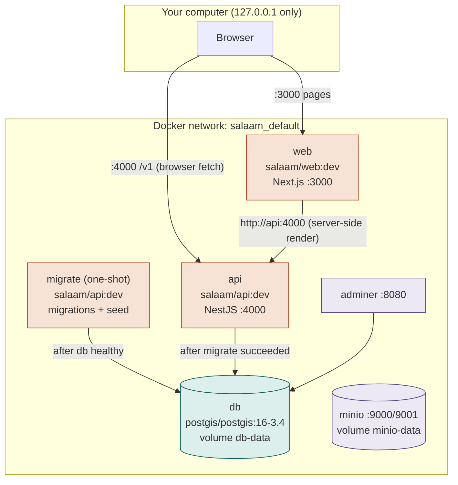
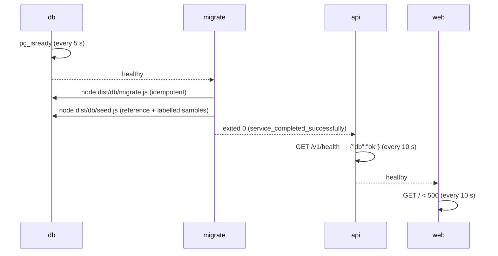

# Docker Architecture (local development)

Status: implemented · config validated · 2026-11-17 · see BLOCKERS BL-03 for what could not be run here

Design goals: one command to start everything, laptop-friendly (≤16 GB RAM), nothing listening beyond
`127.0.0.1`, no secrets in images, and the same API image for migrations and serving.

## 1. Services and profiles

| Profile | Command | Services | Use it when |
|---|---|---|---|
| *(core, default)* | `docker compose up -d` (`make db`) | db | You run api/web natively with `pnpm` for fast reloads |
| `full` | `docker compose --profile full up --build -d` (`make up`) | db → migrate → api → web | You want the whole product running with one command |
| `tools` | `docker compose --profile tools up -d` (`make tools`) | + adminer | You want to look inside the database |
| `storage` | `docker compose --profile storage up -d` | + minio | From media uploads onward (not used by code yet) |

Not created on purpose (no empty services): `mock` (no external providers integrated yet; sample data is
the DS-003 seed), `observability` (deferred until staging; see OBSERVABILITY section in SYSTEM_ARCHITECTURE),
`worker` (no background jobs yet; ingestion is L0/L1 manual through MVP-1).

## 2. Start order and health

## 3. Images

| Image | Dockerfile | Stages | Runtime contents | Verified |
|---|---|---|---|---|
| `salaam/api:dev` | `infra/docker/api.Dockerfile` | deps → build → prod-deps → runtime | compiled JS, SQL migrations, production `node_modules` only (≈47 MB of app files), user `node` | Runtime file set executed natively: migrate + seed + serve + HEALTHCHECK command ✅ |
| `salaam/web:dev` | `infra/docker/web.Dockerfile` | deps → build → runtime | Next.js standalone server + static assets (≈84 MB), user `node` | Standalone server executed natively: `/`, `/discover`, `/staff/review` → 200 ✅ |

`NEXT_PUBLIC_API_URL` is a build argument because it is compiled into the browser bundle. The web server
itself calls the API at `API_INTERNAL_URL` (`http://api:4000` inside the network).

## 4. Security notes

- All published ports bind to `127.0.0.1` — not reachable from your Wi-Fi network.
- Credentials in `compose.yaml` are local-only placeholders; production uses a secret store (DEPLOYMENT, later).
- `DEV_AUTH=true` is set only in this compose file; the API refuses to start with it in production.
- `.dockerignore` keeps `.env`, `.git`, docs and local builds out of the build context.
- Images run as the unprivileged `node` user.

## 5. Data safety

- Data lives in the named volume `db-data`; `make down` keeps it.
- `make backup` writes `backups/salaam_dev-<timestamp>.dump` and checks it is readable.
- `make restore FILE=…` asks you to type the database name before replacing anything.
- `make reset` deletes the volume and asks you to type `reset` first.
- Backup → restore was tested end to end (row counts identical).

## 6. Verification record

| Check | Result |
|---|---|
| `docker compose config` for core / full / tools / storage / full+tools | ✅ valid, expected services |
| API image steps (install → build → prod install → runtime copy) executed natively | ✅ |
| `node dist/db/migrate.js && node dist/db/seed.js` on an empty PostGIS database | ✅ |
| API HEALTHCHECK command | ✅ exit 0 |
| Web standalone server serving public + staff pages against the API | ✅ |
| Backup → restore into a fresh database | ✅ identical counts |
| Pull base images / `docker compose up` | ❌ not possible here: Docker Hub is blocked by this environment's network policy (BL-03). Run `make up` on your machine. |
