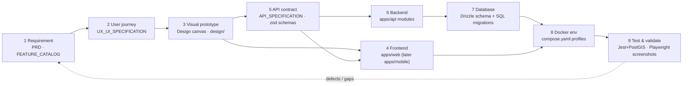
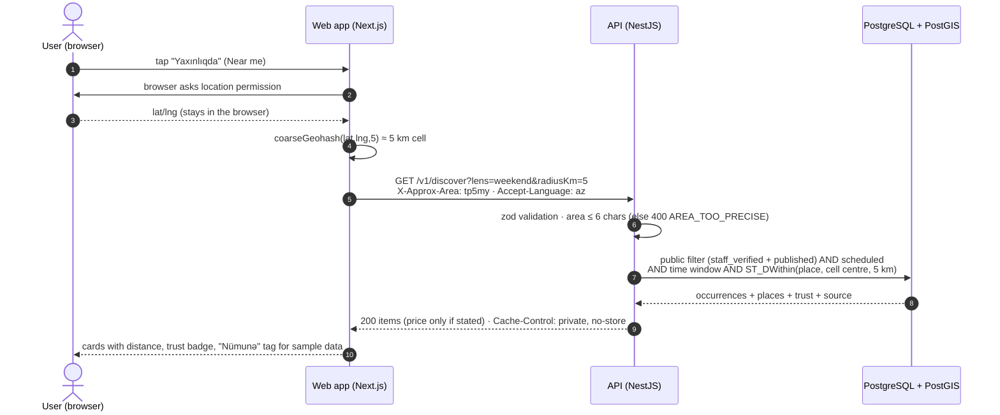

# Feature Traceability: from design to a working feature

Status: living document · updated 2026-11-17 · owner: Lead Architect

This is the central map of how a Salaam feature travels from "what the user wants" to "verified, running code",
and where each feature currently stands. If a row says IMPLEMENTED, there is code, a test and a screenshot for it.

## 1. The 9-stage pipeline (target, checked against the repository)

Stage 5 (API contract) is drawn before 4 on purpose: the frontend is built against the contract, not
against whatever the backend happens to return. That is how ADR-0020 intends it.

| # | Stage | Question it answers | Where it lives in the repo | Gate to pass before the next stage | Current reality |
|---|---|---|---|---|---|
| 1 | Product requirement | What does the user want to do, and why? | `docs/PRODUCT_REQUIREMENTS_DOCUMENT.md`, `docs/FEATURE_CATALOG.md` (FR-xxx), `docs/PRODUCT_DECISIONS.md` (D-xx) | Requirement has an ID, acceptance criteria and an MVP priority | ✅ in place |
| 2 | User journey | Which screens and steps, which error branches? | `docs/UX_UI_SPECIFICATION.md` (journeys + screen inventory) | Each step names its screen, API call and failure path | ✅ for discovery, organizer and review journeys |
| 3 | Visual prototype | What does each screen look like (mobile + desktop)? | Design canvas "Salaam — First Look" (Concepts A & C) in claude.ai; tokens in `apps/web/src/app/(public)/public.css`; evidence in `design/screenshots/` | Hi-fi frame + loading/empty/error states + a11y notes | ⚠️ no Figma connector in this environment; the Figma-compatible package (tokens JSON, SVG frames) is still open (TB-14) |
| 4 | Frontend | Components, navigation, interaction | `apps/web/src/app/(public)` (public app), `apps/web/src/app/staff` (staff portal) | Builds; every state rendered; screenshot captured | ✅ web; mobile (Expo) not started (stage S2) |
| 5 | API contract | What data crosses the wire? | `docs/API_SPECIFICATION.md`, request schemas in `packages/domain` + controllers (zod), errors RFC 9457 | Schema is validated at the edge; contract test exists | ✅ `docs/openapi.json` generated from zod; web types generated; contract tests + CI drift check |
| 6 | Backend | Business rules and request handling | `apps/api/src/modules/*` (catalog, sources, events, organizer, review) | Authorization + validation + audit in the same transaction | ✅ |
| 7 | Database | Storage and retrieval | `apps/api/src/db/schema.ts`, `apps/api/drizzle/*.sql`, PostGIS + pg_trgm | Migration reviewed; constraints enforce invariants (e.g. publish CHECK) | ✅ |
| 8 | Docker environment | Start all required services with one command | `compose.yaml`, `infra/docker/*.Dockerfile`, `Makefile` | `docker compose config` valid; images build; healthchecks green; smoke test | ✅ images build and full stack runs healthy in CI with smoke tests |
| 9 | Testing & validation | Does the whole chain work? | `apps/api/test/*.spec.ts` (real PostGIS), Playwright screenshot script, `TEST_RESULTS.md` | All tests pass; screenshots match design; security checklist reviewed | ✅ 31 integration tests; screenshots for the public slice |

## 2. Request lifecycle for one feature (Discover nearby)

Nothing in this path stores or logs the location: the exact position never leaves the browser, and the
coarse cell travels in a header that is not logged.

## 3. Traceability matrix

Statuses follow the master directive: NOT_STARTED · DESIGNED · IN_PROGRESS · IMPLEMENTED · TESTED · BLOCKED · RELEASE_READY.
"TESTED" means automated tests and visual evidence exist; it does not mean release-ready.

| ID | Feature (requirement) | Journey | Design | Frontend | API | Backend module | Database | Data source | Security / privacy | Tests | Evidence | Status |
|---|---|---|---|---|---|---|---|---|---|---|---|---|
| F-01 | Avatar-first home: companion in the centre, event objects around, moods | Open app → pick mood/object → open event | Companion World (FD-01/02) | `(public)/page.tsx`, `companion-world.tsx`, `avatar-alive.tsx`, `EventCard` | `GET /v1/discover` | events/DiscoverService | events, occurrences, places | DS-001/002 (+DS-003 sample, dev only) | Rule-based text, no AI; reduced-motion honoured | API: invariants.spec; UI: screenshot | `01-home-mobile-az.png`, `06-home-desktop-en.png` | TESTED |
| F-02 | Time lenses (Now / Tonight / Weekend) | Home/Discover → choose lens | Concept A chips | lens chips (home, discover) | `lens=now\|tonight\|weekend\|date` | `common/time.ts` lensWindow (Asia/Baku) | occurrence time overlap | — | — | time.spec (window maths) | `02-home-weekend-mobile.png` | TESTED |
| F-03 | Nearby discovery with coarse location | Discover → Near me → radius | Discover screen | `discover-client.tsx`, `lib/geohash.ts` | `X-Approx-Area` header | DiscoverService (ST_DWithin) | GiST on `places.location` | — | D-28: geohash ≤6, never stored/logged, `Cache-Control: private` | invariants.spec (radius, precision, cache header) | `03-discover-nearby-mobile.png` | TESTED |
| F-04 | Event details with trust & source | Card → details → tickets/map | Details screen | `(public)/e/[id]/page.tsx` | `GET /v1/occurrences/:id` | DiscoverService.occurrence | provenance, sources | — | Price/time never invented; synthetic pages `noindex` | invariants.spec (time unknown, no price) | `04-event-details-mobile.png`, `05-event-details-ru.png` | TESTED |
| F-05 | Add to calendar (.ics) | Details → add to calendar | Details actions | `calendar-button.tsx` (client-side file) | — | — | — | — | No data leaves device | manual only | — | IMPLEMENTED |
| F-06 | Organizer submits event | Organizer form → in review | Staff portal (plain) | `staff/organizer` | `POST/GET /v1/organizer/:orgId/submissions` | organizer | source_items, review_tasks | DS-002 | Membership check; rights confirmation; dedup | review-flow.spec | `08-staff-review.png` (form not captured) | TESTED |
| F-07 | Human review → publish (D-25) | Queue → evidence → approve/reject | Staff portal (plain) | `staff/review/[id]` | `POST /v1/admin/review-tasks/:id/decision` | review + PublicationService | events (CHECK), audit_logs | DS-002 | Only human publish path; audit in same tx | review-flow.spec | `08-staff-review.png` | TESTED |
| F-08 | Curator manual entry from official link | Events → manual entry | Staff portal | `staff/events` | `POST /v1/admin/events` | events | events, provenance | DS-001 | sourceUrl required | invariants.spec | — | TESTED |
| F-09 | Cancellation / lifecycle change | (staff) mark cancelled | — | not in UI yet | `PATCH /v1/admin/occurrences/:id/lifecycle` | events | occurrences, provenance, audit | — | Human-only, audited | review-flow.spec | — | IMPLEMENTED (API only) |
| F-10 | Language switch az/ru/en | Any screen → AZ/RU/EN | Header control | `chrome.tsx` LangSwitch, `lib/i18n.ts` | `Accept-Language` | `resolveLocalized` fallback | localized jsonb | — | — | time.spec (fallback) | `05-event-details-ru.png` | TESTED |
| F-11 | Sample data isolation | — | "Nümunə" tag | tag + note | `attribution.synthetic` | DiscoverService publicFilter | `sources.is_synthetic` | DS-003 | Never public in production | synthetic.spec | screenshots | TESTED |
| F-12 | Sign-in, saved items, profile | Onboarding → sign in | Screen inventory | — | `/v1/auth`, `/v1/me` | identity | users, sessions | — | Spike S-AUTH pending (ADR-0010) | — | — | NOT_STARTED |
| F-13 | Map view | Discover → map | Spec only | — | bbox query | — | — | OSM tiles | Spike S-MAP pending | — | — | NOT_STARTED |
| F-14 | Mobile app (Android/iOS) | All | Concept A | — | same API | — | — | — | — | — | — | NOT_STARTED |
| F-15 | AI-assisted ingestion | Source → extract → review | — | — | — | — | — | — | D-25: L0/L1 only through MVP-1 | — | — | NOT_STARTED |

## 4. Rules for keeping this matrix honest

- A row moves to TESTED only with a passing automated test **and** visual evidence in `design/screenshots/`.
- Concept/mockup images are never used as evidence for an implemented screen.
- When a feature changes its API, update the row in the same commit.

| Feature | Screen | API | Module | Tests | Screenshot | Status |
|---|---|---|---|---|---|---|
| My World (3D home) | `/` (world) | `GET /v1/discover` | `apps/web/src/world` | build + visual | after/20–23 | IMPLEMENTED |
| Avatar Studio | `/studio` | — (device storage) | `world/StudioHome.tsx` | build + visual | after/24–25 | IMPLEMENTED |
| Experiences (editorial Discover) | `/discover` | `GET /v1/discover` | `(public)/explore-card.tsx`, `covers.tsx` | build + visual | after/26–27 | IMPLEMENTED |
