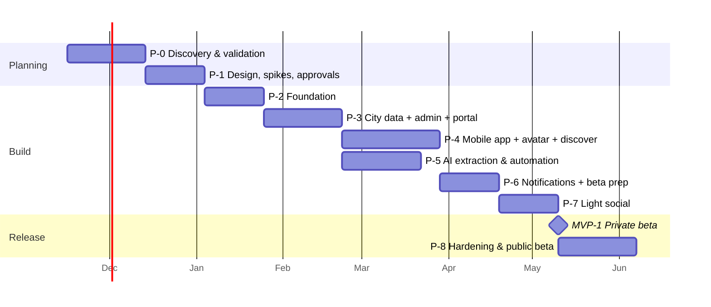

# Implementation Roadmap (Solo Founder)

Status: Draft 0.1 · 2026-11-14 · Related: [MVP_SCOPE.md](./MVP_SCOPE.md), [FEATURE_CATALOG.md](./FEATURE_CATALOG.md), [COST_AND_RESOURCE_ESTIMATE.md](./COST_AND_RESOURCE_ESTIMATE.md), [RISKS_AND_OPEN_QUESTIONS.md](./RISKS_AND_OPEN_QUESTIONS.md)

## 1. Assumptions

- One founder working with Claude Code; capacity assumed **~20 focused hours/week** [ASSUMPTION — owner to confirm]. Effort is given in **dev-days** (≈6 focused hours); calendar time scales with real capacity.
- Estimates are ranges with high uncertainty; re-estimated at each gate.
- Order follows the dependency "supply before experience": the admin and data pipeline exist before the consumer app relies on them.
- Development process: DISCOVERY → FEASIBILITY → REQUIREMENTS → ARCHITECTURE → DOCUMENTATION → **APPROVAL** → IMPLEMENTATION → TESTING → REVIEW → RELEASE ([CONFIRMED]).

## 2. Phase overview

*Calendar dates are illustrative only, assuming ~20 h/week and starting after approval.*

## 3. Phases

### P-0 Discovery & validation (no code)
- **Objective:** validate supply (A1, A2, A8), demand (A3), avatar value (A4), organizer willingness (A5).
- **Deliverables:** 4-week curation sprint spreadsheet; 12–15 interviews; Telegram/Instagram pilot channel; 20 venue pitches; gold-set seed (≥150 announcements); counsel engaged with QL list; ≥12 Android testers recruited.
- **Dependencies:** owner approval of this documentation.
- **Risks:** low supply → re-scope categories.
- **Acceptance / gate G0:** A1 passed (≥100/week for 3 of 4 weeks) or scope revised; ≥5 organizers willing; interview synthesis written.
- **Effort:** 15–25 founder-days (non-dev).

### P-1 Design, spikes, approvals
- **Objective:** remove technical unknowns; finalize UX; record decisions.
- **Deliverables:** spike S-AV1 (Rive avatar, 3–5 dd); spike S-MAP (MapLibre RN + PMTiles, 2–3 dd); spike S-AUTH (auth library, 1–2 dd); clickable prototypes A vs C tested; style board; ADRs updated to Accepted/Rejected; OpenAPI v1 draft; hosting quotes; legal answers for QL-01–QL-04 (target).
- **Gate G1:** spikes meet exit criteria; D-03, D-05, D-06, D-07, D-08, D-14, D-15 approved.
- **Effort:** 10–15 dd.

### P-2 Project foundation
- **Objective:** a running skeleton anyone (future collaborator) can set up in <30 min.
- **Deliverables:** monorepo; CI (lint, typecheck, tests, secret scan, dependency audit); Docker Compose (Postgres+PostGIS, MinIO); DB migrations framework; identity + consent modules; i18n framework; OpenAPI generation; error tracking; `.env.example`; CLAUDE.md conventions; backup/restore scripts.
- **Gate G2:** sign-in (email OTP + Google) works on web; consent records stored; CI green; restore test passes.
- **Effort:** 12–18 dd.

### P-3 City data, admin console, organizer portal
- **Objective:** curators can create and publish verified content; organizers can submit.
- **Deliverables:** places/organizers/events/occurrences/cinema modules; status model & provenance; admin CRUD; review queue (manual tasks); source registry + connector framework with `manual_entry`, `organizer_portal`, `ics_feed`, `rss_feed`, `osm_import`; job scheduler; job monitor; audit log; public web event/place pages (basic).
- **Gate G3:** founder publishes ≥100 occurrences/week through the admin for 2 weeks; adding an RSS/ICS source requires no code.
- **Effort:** 20–30 dd.

### P-4 Mobile app, avatar, discover
- **Objective:** the consumer experience.
- **Deliverables:** Expo app (dev builds); onboarding; avatar editor + home (Concept A + flag C); discover (lenses, filters, search, list/map); detail pages; save; directions/hand-off links; static avatar renders; Apple/Google sign-in on mobile; web public pages polished (SEO/OG).
- **Gate G4:** acceptance criteria E1–E3 met ([MVP_SCOPE.md](./MVP_SCOPE.md#4-acceptance-criteria-by-epic)); performance NFR-001 on reference device.
- **Effort:** 30–45 dd (largest phase).

### P-5 AI extraction & progressive automation (can overlap P-4)
- **Objective:** reduce curator effort without losing accuracy.
- **Deliverables:** model gateway with budgets; LLM extraction with evidence spans; validation; matching & dedup suggestions; policy engine + automation levels; audit sampling; quality dashboard; translation; gold-set eval in CI; Meta App Review submission and `instagram_owned_account` connector (if approved); pre-event re-verification.
- **Gate G5:** extraction critical-field precision ≥90% on gold set; curator minutes/item reduced ≥30% vs P-3 baseline.
- **Effort:** 15–25 dd.

### P-6 Notifications & beta preparation
- **Deliverables:** push (Expo relay), inbox, preferences, quiet hours, budgets, reminders, change alerts, weekend digest; deep links; store listings; privacy policy & terms (counsel-reviewed); Android closed test (12 testers × 14 days); TestFlight; hosting decided and production environment set up.
- **Gate G6:** E4, E8 met; legal prerequisites for MVP-1 satisfied (QL-01–QL-04, QL-10).
- **Effort:** 12–18 dd.

### P-7 Light social
- **Deliverables:** friends, blocks, invites (deep links), going/interested with visibility, friends going, follows, reports, moderation queue.
- **Gate G7:** E5 met; visibility test matrix green; privacy review done. → **MVP-1 private beta** (50–200 users).
- **Effort:** 10–15 dd.

### P-8 Hardening & public beta
- **Deliverables:** security checklist (ASVS L1, API Top 10), load test, accessibility audit, analytics, backup drills, incident runbook, beta feedback fixes, public store release.
- **Gate G8:** MVP-1 metrics trending to targets ([MVP_SCOPE.md](./MVP_SCOPE.md#5-success-metrics)); no critical security findings. → **MVP-2 public beta**.
- **Effort:** 15–20 dd.

## 4. Totals

| Range | Dev-days (P-1…P-8) | Calendar at ~20 h/week |
|---|---|---|
| Optimistic | ~125 | ~9 months |
| Expected | ~150–170 | ~11–12 months |
| Pessimistic | ~200 | ~14 months |

Plus P-0 (~1 month, mostly non-dev). These are estimates for planning, not commitments.

## 5. What must be complete before moving forward (gate summary)

| Gate | Hard requirement |
|---|---|
| G0 | Supply validated or scope revised; owner approves continuing |
| G1 | Avatar spike passes; key decisions approved |
| G2 | Foundation, CI, backup/restore |
| G3 | Admin publishing at target volume |
| G4 | Consumer acceptance criteria |
| G5 | Extraction quality on gold set |
| G6 | Legal prerequisites & hosting decided **before real user data** |
| G7 | Privacy/visibility tests |
| G8 | Security & metrics review |

## 6. Post-MVP candidates (evidence-driven)

AI assistant (F-090), shared plans (F-032), avatar unlockables & inventory items (F-013/F-014/F-121), partner feeds, more cities (Sumgait, Ganja), deals (F-100), passkeys, phone OTP, groups/communities (F-045).
