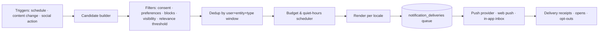

# Notification Architecture

Status: Draft 0.1 · 2026-11-14 · Related: [AI_CITY_INTELLIGENCE.md](./AI_CITY_INTELLIGENCE.md), [ADR-0016](./adr/ADR-0016-push-notifications-expo.md), [DATABASE_DESIGN.md](./DATABASE_DESIGN.md), [SECURITY_AND_PRIVACY.md](./SECURITY_AND_PRIVACY.md)

## 1. Goals

Send few, genuinely useful notifications at the right time; never spam; full user control; never send every discovered item to every user.

## 2. Notification types

| Type | Class | Default | Consent needed | Example |
|---|---|---|---|---|
| `reminder` | Transactional (user-initiated) | On | No (user saved item) | "Jazz night starts in 2 hours" |
| `change_alert` | Transactional | On | No | "Time changed for an event you saved" / "Cancelled" |
| `friend_request` / `invite` | Social | On | No | "Murad invited you to …" |
| `friend_going` | Social | Off | Social notifications opt-in | "2 friends are going to …" |
| `weekend_digest` | Digest | Off (offered in onboarding) | Opt-in | Thursday 18:00 |
| `tonight_digest` | Digest | Off | Opt-in | Daily 17:00, only if ≥3 strong matches |
| `followed_update` | Follow | On for followed places/organizers | No | "New event at a place you follow" |
| `personalized_suggestion` | AI/personalised | Off | **Separate consent** | Next (post-MVP) |
| `nearby` | Location-based | Off | **Separate consent** + precise location on device | Later |
| `system` | Account/security | On (cannot disable) | No | "New sign-in" |

## 3. Pipeline

## 4. Rules

| Rule | Default |
|---|---|
| Daily budget (non-transactional + social + digests) | 2 per user per day (user-adjustable 0–5) |
| Quiet hours | 22:00–09:00 Asia/Baku (user-adjustable); transactional `change_alert` for same-day events may bypass only if user enabled "urgent changes" |
| Dedup window | Same (user, entity, type) not more than once per 24 h |
| Digest suppression | Skip digest if fewer than 3 items above relevance threshold |
| Fatigue protection | If user dismisses 3 consecutive digests → halve frequency; ask in-app whether to keep |
| Priority order when over budget | change_alert > reminder > invite/friend_request > followed_update > digest > friend_going |
| Expiry | Undelivered notifications expire at entity start time (or 24 h) |

## 5. Channels

| Channel | MVP | Notes |
|---|---|---|
| iOS push | ✓ | Via APNs; Apple Developer Program membership required for remote push |
| Android push | ✓ | Via FCM |
| Expo Push Service (relay to APNs/FCM) | ✓ recommended | Free relay per vendor comparisons; payloads pass through Expo → send IDs and minimal text only ([ADR-0016](./adr/ADR-0016-push-notifications-expo.md)) |
| Web push | Optional | VAPID; for logged-in web users |
| In-app inbox | ✓ | Source of truth; every push has an inbox entry |
| Email | ✗ (account emails only) | Sign-in codes, account notices |

Abstraction: a `PushProvider` interface allows switching from Expo relay to direct APNs/FCM without changing upstream stages.

## 6. Deep links

Every notification carries a route (`/e/{occurrenceId}`, `/invite/{token}`, `/settings/notifications`) resolved by app/universal links; web fallback pages exist for all routes ([UX_UI_SPECIFICATION.md](./UX_UI_SPECIFICATION.md#2-information-architecture--navigation)).

## 7. Data model (summary)

`notification_preferences` (per user & category, quiet hours, budget), `notifications` (logical notification: type, entity, payload ids, locale, scheduled_for, status), `notification_deliveries` (per device/channel attempt, provider id, status, error), `devices` (push tokens, platform, app version, last seen). Details in [DATABASE_DESIGN.md](./DATABASE_DESIGN.md#58-notifications).

## 8. Metrics

Opt-in rate, opt-out rate per type, open rate per type, notifications per user per day (distribution), delivery failure rate, time-to-alert for cancellations. Target thresholds in [MVP_SCOPE.md](./MVP_SCOPE.md#5-success-metrics).

## 9. Privacy

- Payloads contain no precise location, no friend lists, minimal text; sensitive details fetched in-app after open.
- Location-based and personalised types require separate consents (FR-113) and are not in MVP.
- Tokens deleted on sign-out and account deletion.
