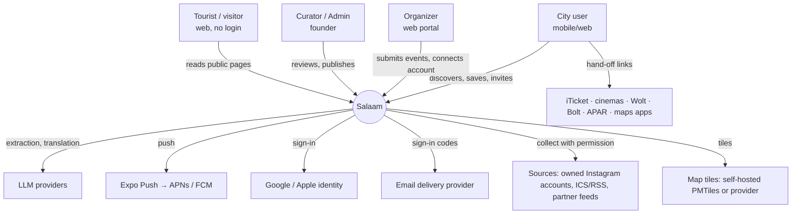
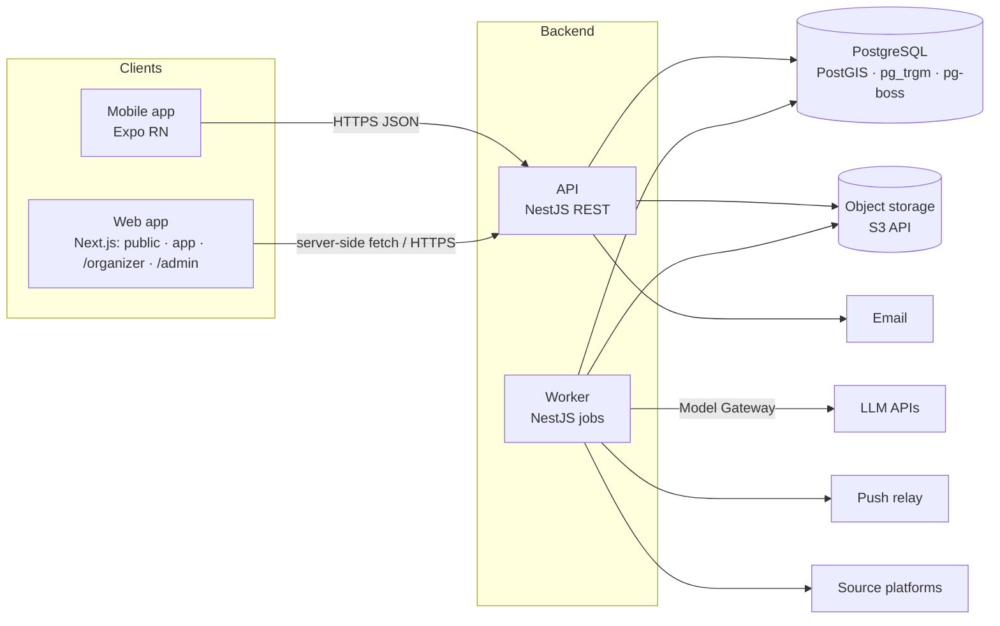
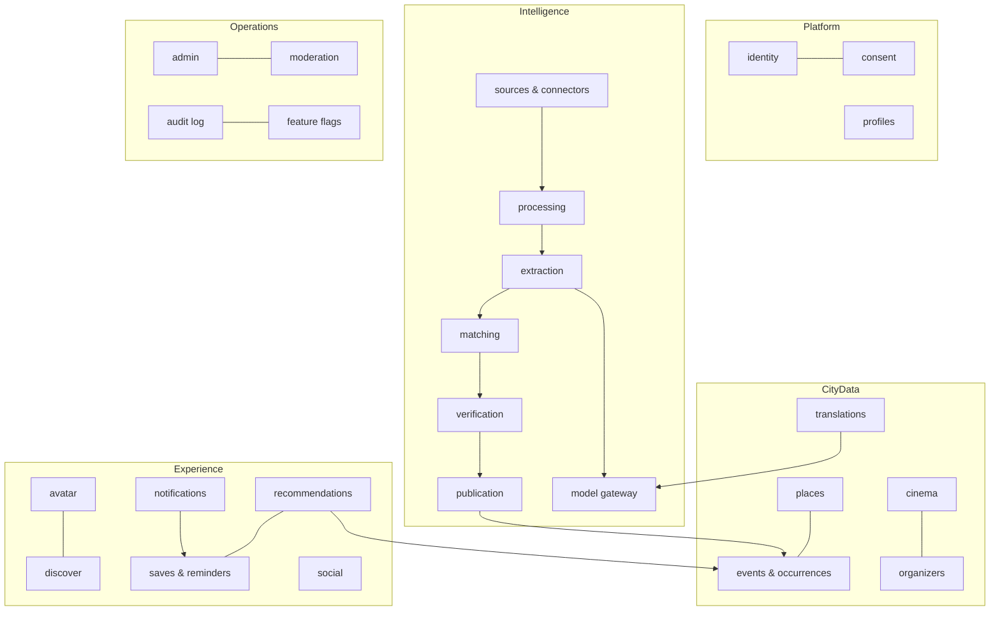

# System Architecture

Status: Draft 0.1 · 2026-11-14 · Related: [ARCHITECTURE_REVIEW.md](./ARCHITECTURE_REVIEW.md), [DATABASE_DESIGN.md](./DATABASE_DESIGN.md), [API_SPECIFICATION.md](./API_SPECIFICATION.md), [adr/README.md](./adr/README.md)

## 1. Architecture summary

[RECOMMENDED] A **modular monolith** ([ADR-0001](./adr/ADR-0001-modular-monolith.md)) in a TypeScript monorepo ([ADR-0002](./adr/ADR-0002-monorepo-pnpm-turborepo.md)):

- **Mobile app** — Expo / React Native, iOS + Android ([ADR-0003](./adr/ADR-0003-mobile-expo-react-native.md))
- **Web app** — one Next.js application serving public pages, logged-in web, organizer portal and admin console ([ADR-0004](./adr/ADR-0004-web-nextjs-single-app.md))
- **API** — NestJS, REST + OpenAPI ([ADR-0005](./adr/ADR-0005-backend-nestjs.md), [ADR-0020](./adr/ADR-0020-api-rest-openapi-contract-first.md))
- **Worker** — same NestJS codebase, separate process, runs jobs ([ADR-0009](./adr/ADR-0009-background-jobs-pg-boss.md))
- **PostgreSQL + PostGIS + pg_trgm** (pgvector later) ([ADR-0006](./adr/ADR-0006-postgresql-postgis.md), [ADR-0007](./adr/ADR-0007-search-postgres-fts-trgm.md), [ADR-0008](./adr/ADR-0008-pgvector-deferred.md))
- **S3-compatible object storage** ([ADR-0011](./adr/ADR-0011-object-storage-s3-compatible.md))
- External: LLM providers via Model Gateway ([ADR-0014](./adr/ADR-0014-ai-model-gateway.md)), push relay ([ADR-0016](./adr/ADR-0016-push-notifications-expo.md)), map tiles ([ADR-0013](./adr/ADR-0013-maps-maplibre-osm.md)), email delivery, source platforms.

Hosting location is deliberately undecided; everything runs in containers on any provider ([ADR-0017](./adr/ADR-0017-hosting-portable-deferred.md)).

## 2. C4 Level 1 — System context



## 3. C4 Level 2 — Containers



| Container | Responsibility | Scaling path |
|---|---|---|
| Mobile app | UI, avatar runtime, maps, local caching, deep links | Store releases + OTA updates |
| Web app | SSR public pages (SEO/sharing), logged-in web, organizer portal, admin | Horizontal containers; CDN caching for public pages |
| API | Auth, business logic, authorization, OpenAPI | Horizontal, stateless |
| Worker | Collection, processing, extraction, matching, publication, notifications, maintenance | Multiple worker processes per queue |
| PostgreSQL | System of record, jobs, search, geo | Vertical first; read replica later |
| Object storage | Images, avatar static renders, map tiles (PMTiles), exports, backups | Provider-managed |

## 4. C4 Level 3 — API/worker modules (bounded contexts)



**Module boundary rules**
1. A module owns its tables; other modules access them only through the owning module's service interface (no cross-module SQL joins in application code except through read models defined by the owner).
2. Cross-module side effects use **domain events** recorded in an outbox table and processed by the worker (e.g. `occurrence.cancelled` → notifications).
3. Lint rules enforce import boundaries (dependency graph check in CI).
4. Any module can be extracted into a service later because communication is already via interfaces/events.

| Module | Owns | Publishes events | Consumes |
|---|---|---|---|
| identity | users, auth accounts, sessions | `user.created`, `user.deleted` | — |
| consent | consents | `consent.changed` | — |
| profiles | profiles, privacy settings | `profile.updated` | `user.deleted` |
| avatar | avatar configs, catalog, user items | `avatar.updated` | `user.deleted` |
| places / events / cinema / organizers | city data | `occurrence.published/changed/cancelled` | publication |
| sources & connectors | sources, source_items | `source_item.collected` | — |
| processing / extraction / matching / verification | extraction results, match candidates, review tasks | `item.ready_for_review`, `item.approved` | upstream |
| publication | field provenance; writes city data via owners | — | `item.approved` |
| recommendations | (read models only) | — | city data, saves, social |
| saves & reminders | saves, reminders | `reminder.due` | occurrence events |
| social | friendships, follows, attendances, invites, blocks | `friend.requested`, `invite.created` | — |
| notifications | preferences, notifications, deliveries, devices | — | many |
| moderation | reports, actions | — | — |
| admin | (UI composition) | — | — |
| audit | audit logs | — | all admin actions |

## 5. Repository & module structure (planned)

Not created yet (no implementation authorized). Planned layout:

```
salaam/
  apps/
    mobile/        Expo app
    web/           Next.js (public, app, organizer, admin)
    api/           NestJS API entrypoint
    worker/        NestJS worker entrypoint (shares modules with api)
  packages/
    domain/        Backend modules (bounded contexts) shared by api & worker
    api-client/    Generated from OpenAPI
    ui-tokens/     Design tokens
    i18n/          Message catalogs (az, ru, en)
    avatar-schema/ Avatar config schema + catalog types
    config/        Shared lint/tsconfig
  docs/            This documentation
  infra/           Compose files, deployment scripts (later)
```

## 6. Communication

| Path | Mechanism |
|---|---|
| Clients → API | HTTPS JSON REST, bearer access token (short-lived) + refresh token rotation |
| Web SSR → API | Server-side fetch with service token for public data; user token for logged-in pages |
| API → Worker | Jobs in pg-boss (same database) and outbox events |
| Worker → external | HTTPS with per-provider rate limiters and circuit breakers |
| Realtime | Not in MVP (polling + push); WebSockets considered for chat/live features later |

## 7. Deployment topologies

| Stage | Topology | Notes |
|---|---|---|
| Local development | Docker Compose: Postgres (PostGIS image) + MinIO; API, worker, web, mobile run natively | Only 2 containers → laptop-friendly |
| MVP-0 prototype | One small VPS (or AZ cloud VM): Postgres + API + worker + web in containers behind a reverse proxy with automatic TLS; object storage provider; nightly encrypted backups to separate storage | Synthetic users only |
| MVP-1/2 beta | Same, or managed Postgres + app VM; decided with D-02 | Add uptime monitoring and offsite backups |
| Growth | Separate DB host, 2 app nodes, CDN for public pages and media | Only when metrics justify |

Configuration via environment variables (12-factor); secrets never in the repo; `.env.example` documents variables.

## 8. Observability

- Structured JSON logs with request IDs; error tracking (free tier of a hosted service or self-hosted — decided in P-2); job dashboard in admin; uptime check on public endpoints; alerts to founder (email/Telegram).
- Key business metrics derived from database (no third-party analytics SDK in MVP unless privacy-reviewed).

## 9. Key quality attributes and how the architecture addresses them

| Attribute | Approach |
|---|---|
| Solo operability | Few containers, one database, scripted deploy/backup/restore |
| Cost | Free tiers + small VPS; LLM budgets; self-hosted tiles option |
| Portability (legal) | Containers + Postgres + S3 API; no proprietary BaaS lock-in |
| Trust/data quality | Provenance and status model in schema; policy engine; audit sampling |
| Privacy | Coarse location; consent module; data minimisation in LLM calls |
| Extensibility | Connector contract; widget descriptors; module boundaries; catalog-driven avatar |
